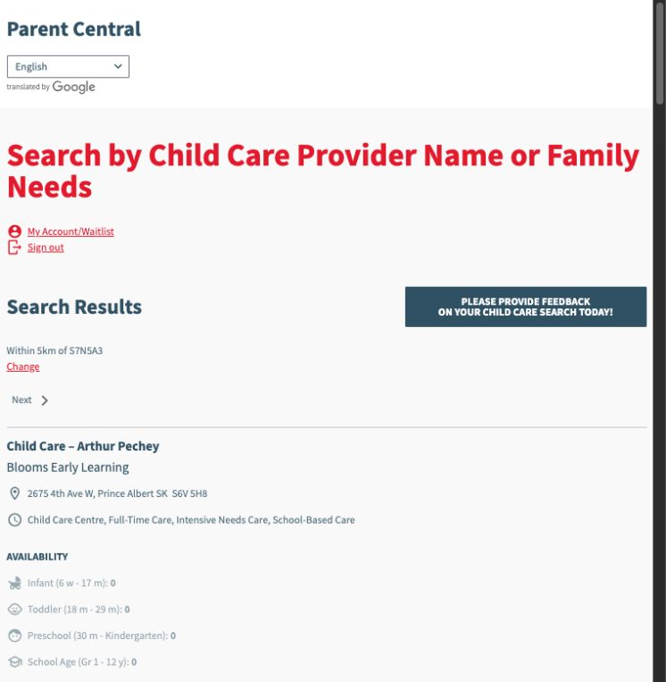
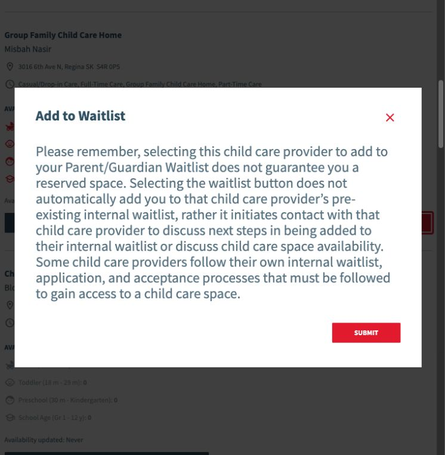
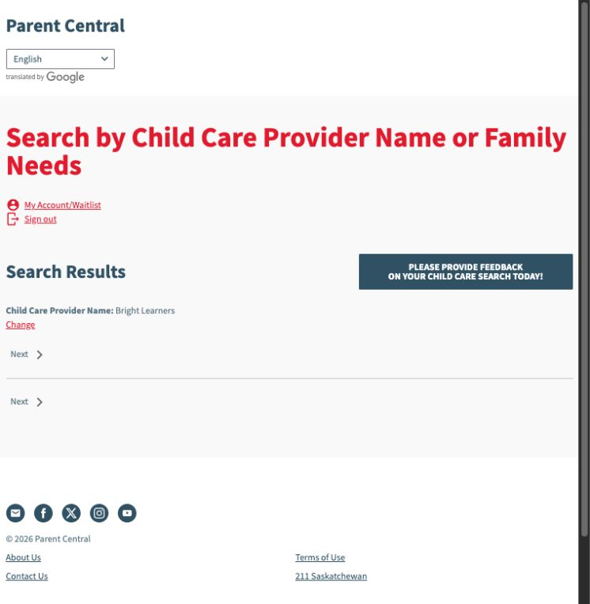

# Parent Central family experience and proposed dashboard

Reviewed November 25, 2026, Saskatchewan time. Prepared for the AI Solutions Architect, AI Office, Government of Saskatchewan.

The largest opportunity is to connect discovery, applications and provider responses. Families should be able to find suitable care, reuse their information and know whether a provider has actually received and accepted their waitlist request. A simpler interface depends on reliable provider records and participation in that workflow.

## What the current experience does

The observed journey is: search by provider or family needs → scan results → open details → use Parent Central’s contact initiation or follow the provider’s separate process → track the relationship through the provider’s own arrangements.

The signed-in test account has a profile, children and a waiting-list section. The profile collects contact details, a desired start date, communication preference and each child’s name and birth date. Its empty waiting-list state provides little guidance on what to do next. The signed-in search uses the profile’s postal code and child age; those were displayed as text rather than editable search fields. [Account](https://parentcentral.sk.211.ca/account/) · [Registration fields](https://parentcentral.sk.211.ca/register/)

The Parent Central waitlist modal explicitly distinguishes initiating contact from joining a provider’s internal waitlist. Providers retain their own admission processes, and providers supply availability updates. Participation and detail can vary. [Terms, sections 14 and 15](https://parentcentral.sk.211.ca/terms-of-use/)

An external example makes the duplication concrete: Blooms’ form asks again for parent and child names, email, birth date and desired start, with optional support and dietary information. Its page says registration follows a space becoming available. [Blooms intake](https://www.bloomsway.ca/register-now)

YMCA Aspen Ridge has a separate two-page PDF, one application per child, emailed to the centre. It requests child and guardian details, sibling information, support needs, start date and a declaration. It also says staff cannot respond to application-status inquiries because of volume. [YMCA application](https://ymcasaskatoon.org/wp-content/uploads/2025/05/Childcare-Waitlist-Application-Form-2025V1.1_WEB-Aspen-Ridge.pdf)

## Verified problems and consequences

| Priority | Observation | Consequence for a family |
| --- | --- | --- |
| High | The supplied 5 km Saskatoon search showed Prince Albert and Regina results. This recurred with optional service filters removed. | Families cannot confidently rely on the distance filter. The technical cause is unverified. |
| High | Some results show availability last updated in 2021; others say Never while displaying zero places. | Unknown or stale information resembles a confirmed lack of spaces. |
| High | Searching Brighton returned an empty results area, although searching YMCA returned a Brighton location. | A location can exist but be difficult to discover by its familiar name. |
| Medium | Empty name-search results still displayed Next links without an explanatory message. | Families cannot tell whether there are no matches or the search has failed. |
| Medium | Several records use disabled Contact Provider Directly buttons, while contact routes are in details. | The apparent next action cannot be activated. |
| Medium | Results repeat all four age groups; no sort, comparison or distance-per-result control was visible in the reviewed list. | Families have to inspect long lists to establish suitability. |

Evidence: [location search](https://parentcentral.sk.211.ca/child-care/?child-1=infant&postal-code=S7N5A3&within=5), [Brighton search](https://parentcentral.sk.211.ca/child-care/?provider=Brighton), [YMCA search](https://parentcentral.sk.211.ca/child-care/?provider=YMCA). These are observations from the reviewed session, not claims that every search fails.

On the Arthur Pechey detail page, fees, hours, eligibility and application instructions were available but distributed across sections. Its main website link contained a duplicated protocol, while the separate application-process link worked. [Provider details](https://parentcentral.sk.211.ca/services/prince-albert-4th-ave-w/child-care-arthur-pechey/)

## The four examples raised by the user

| Provider | Finding | Required improvement |
| --- | --- | --- |
| YMCA Child Care Aspen Ridge | Found through YMCA name search. Availability showed Never updated. The provider’s eligibility starts at 18 months, which matters for an infant search; this does not establish why a particular search omitted it. | Explain age suitability and future eligibility; show unknown availability clearly. |
| New Leaf Daycare Aspen Ridge | Present in the supplied 50-result page and the New Leaf name search. Availability showed Never updated. | Make the location easier to identify and provide a direct application route. |
| Blossoms Early Learning Home | No visible results for Blossoms or the candidate operator name Jaskiranjeet. A commercial listing and the government directory share an address and phone under different names. This is a strong identity-match candidate, not a confirmed omission from the entire database. | Connect trading names, operator names and locations; review the match before merging. |
| Brighton Family Childcare | Not found in the tested name search. Current operator identity and licensing status remain unverified. | Resolve the provider identity before classifying the cause as missing data, naming, closure or scope. |

Sources: [YMCA Aspen Ridge listing](https://parentcentral.sk.211.ca/services/saskatoon-aspen-ridge/child-care-aspen-ridge-2/), [YMCA locations and age groups](https://ymcasaskatoon.org/early-learning-and-childcare/), [New Leaf Aspen Ridge listing](https://parentcentral.sk.211.ca/services/new-leaf-daycare-aspen-ridge/child-care-aspen-ridge/), [government regulated-provider directory](https://www.saskatchewan.ca/residents/family-and-social-support/child-care/find-a-child-care-provider-in-my-community), [Blossoms commercial listing](https://www.yellowpages.ca/search/si/1/Learn/Saskatoon%2BSK).

The sample demonstrates discoverability and freshness problems. It does not establish a provincewide number or percentage of missing providers. Bright Learners and Christine Wilmut, sampled from the government directory, also produced empty name-search pages; a known provider, Blooms, returned results as a control.

## Proposed family dashboard

Keep three primary destinations: **Find care**, **My applications**, and **Family profile**. A new family starts in Find care. A returning family starts with the next action on an existing application. Do not fill the home screen with government statistics or an AI chat panel.

### Find care

Begin with the child, care start date, preferred area and required days and times. Derive age at the requested start date. Let parents search near work or another caregiver without changing their account address. Distinguish essential requirements from preferences.

Use a short results list with an optional map. Each result needs:

- Recognizable provider and location name, care type and verified licensing information.
- Distance with its basis identified, opening hours and match to the requested schedule.
- Relevant age eligibility and the reason a provider is or is not suitable.
- Provider-confirmed fees and extra charges, or an explicit unknown value.
- Availability for the requested age and start period, its source and confirmation date.
- A clear action: Apply here, Apply on provider website, or Contact provider.

Keep providers with unknown availability visible. Separate confirmed openings, accepting waitlist applications, full with a closed waitlist, and availability unconfirmed. An old numeric value must not silently remain a current vacancy claim. Closed or inactive facilities should not be offered as operating choices.

Offer comparison of a small shortlist using the same fields. If no matches exist, explain which requirement excluded options and let the parent deliberately widen it. Do not silently expand the area or relax accessibility needs.

### My applications

Each row answers: which child and location, current status, last update, what happens next, and who needs to act. Group items needing the family’s attention first; collapse completed history.

| Status | Evidence needed before displaying it |
| --- | --- |
| Draft | Family has started but not submitted. |
| Sent | Submission was successfully delivered to the participating provider system. |
| Received by provider | Provider or its system acknowledged receipt; show when. |
| More information needed | Provider identified the outstanding item. |
| Waitlist confirmed | Provider explicitly accepted the child onto its actual list. |
| Offer received | A provider issued an offer with terms and a response deadline. |
| Placement confirmed | The enrolment process reached provider-confirmed completion. |

Also support withdrawal, declined applications and expired offers with explanations. Never show a precise queue position or predicted placement date unless the provider’s allocation process and data can support it.

For external applications, retain the destination link and a family-recorded submission date. Label the status **Submitted outside this service — provider confirmation unavailable** until verified. Opening a link is not evidence of applying.

### Family profile and reusable application

Store the minimum reusable information once. Allow a different start date and schedule for each child, sibling preferences, flexible start ranges and multiple contacts. Collect application-specific information only when needed.

The parent chooses providers, reviews what each will receive, answers their additional questions, and submits. Show receipt separately for each provider and child. Share support or medical details only with the selected recipient when needed; do not make them public search-profile fields. Profile changes should show which pending applications will be updated before sending them.

## How coverage and accuracy should work

Use an authorized feed of active licensed facilities as the proposed foundation, with a stable identifier for each facility and location. Public directory access is available today; access to an operational registry feed or API has not been established.

Connect approved licensing events from the provider-application system to directory records: approved opening, approved changes, suspension or closure. An application to open a daycare must not create a public claim that it is operating. Publish only approved public fields, with appropriate handling of home addresses.

Maintain recognized business names, legal/operator names, former names and location names. Match first on stable identifiers, then verified contact/location information. AI may suggest potential duplicates and aliases for review. It should not merge records or certify licensing on a name resemblance alone.

Keep listing coverage independent of online-application participation. An active licensed facility should remain findable even if its only application route is a phone number or external form. If broader unregulated care is included, clearly separate verified licensing, provider declarations and unknown status; absence from a search is not proof of being unlicensed.

Maintain a reconciliation work queue: missing licensed record, unmatched public listing, name/address conflict, inactive record, stale vacancy and broken application link. Assign an owner and record resolution. Measure coverage against the defined active licensed population, not against the number of Google results.

## The provider workflow that makes the dashboard credible

Providers need a small intake queue that lets them acknowledge, request information, confirm waitlisting, issue an offer and confirm enrolment. Each action updates the family’s status automatically. Integrate existing childcare software where practical; provide a simple portal for providers without it.

Vacancies should reflect operating capacity by age and schedule, available staffing, confirmed departures, enrolments and outstanding offers. Licensed capacity minus current enrolment alone is insufficient. A child’s absence must not create a bookable place. Where integrations are unavailable, request a simple confirmation and show its date.

After a placement, ask the family whether other applications should be withdrawn, preserving any genuine remaining need. Count a child seeking one placement once in demand statistics even if there are several applications. Separate children, families, applications, confirmed unmet demand and provider response rates. Deduplication should use account relationships and reviewable records, not opaque AI identity guesses.

## Where AI adds value

| Use | Practical value | Decision boundary |
| --- | --- | --- |
| Explain suitable providers | Turn a parent’s request into editable search criteria and explain matches. | Eligibility and distance use explicit rules and data. |
| Assist applications | Explain questions, translate guidance and draft reusable answers. | Family reviews information and recipients before submission. |
| Improve provider records | Flag conflicting hours, duplicate identities, stale information and broken links. | Verified sources and staff determine published facts. |
| Assist providers | Summarize incoming applications and draft information requests. | Providers decide admission and offers. |

Reliable geospatial search, acknowledgements, status tracking and record synchronization are core software work. AI supports these functions but cannot create vacancies or compensate for providers not participating.

## Recommended delivery sequence

1. **Restore trust in discovery.** Reproduce and fix distance and name-search issues, reconcile licensed records, distinguish unknown availability, repair application links and improve empty results.
2. **Pilot a complete application journey.** Use a small mixed group of centres and family homes. Deliver reusable profiles, provider receipts, confirmed waitlist statuses and reminders. Keep external routes available and honestly labelled.
3. **Connect daily operations.** Add provider-software integrations, vacancy events, offers, enrolment confirmation and deduplicated demand reporting.

Measure whether parents can locate a known provider, identify suitable options, submit without re-entering shared information and confirm the actual waitlist state. Track provider handling time alongside family effort. Establish a baseline before claiming improvement. Set coverage and freshness targets with the service owner.

## Review boundaries and evidence

The review covered the supplied results, a second distance search without optional service filters, signed-in profile and empty waiting-list views, name searches, provider details, the waitlist disclosure, an external web form and the YMCA PDF. No profile updates, provider messages or waitlist submissions were made. Populated account statuses, email delivery, provider administration and backend integrations remain outside this observed session.

The actual browser viewport was 746 pixels wide. A requested 390-pixel override did not change the reported viewport, so phone-size behaviour is not verified. A real mobile and accessibility review remains necessary before implementation sign-off.

